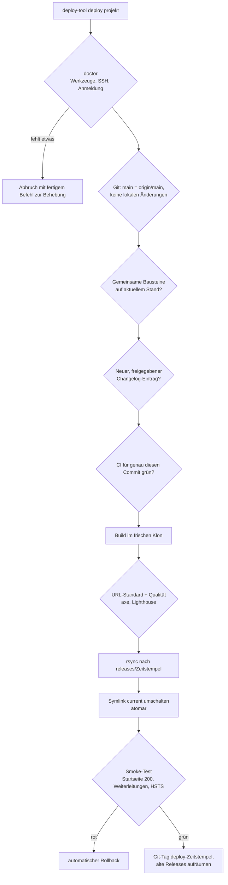

# Deployments, die sich selbst absichern

**Kurz:** Ein Shell-Werkzeug veröffentlicht elf Projekte (statische Astro-Seiten und Laravel-Apps) auf Shared Hosting. Es prüft vor jedem Release alles, was schiefgehen kann, schaltet atomar um und geht bei Fehlern automatisch auf den letzten Stand zurück.

## Problem

Viele kleine Projekte, ein Entwickler, wenig Zeit. Jedes Projekt hatte seinen eigenen Weg auf den Server: mal FTP, mal ein Skript, mal von Hand. Fehler fielen erst live auf, ein Rückweg fehlte, und niemand wusste genau, welcher Stand gerade online ist.

## Randbedingungen

- Shared Hosting ohne Container oder Kubernetes, nur SSH und rsync
- keine Zugangsdaten in GitHub, auch nicht als CI-Secret
- statische Seiten und Laravel mit demselben Ablauf
- Notfall-Rollback muss immer funktionieren, auch wenn das Tool selbst veraltet ist

## Entscheidung

Ein Werkzeug mit einem festen Ablauf. Jeder Schritt ist ein **Gate**: Ist es rot, wird nichts hochgeladen.

Wichtige Details:

- **Atomarer Wechsel:** Releases liegen nebeneinander in `releases/<Zeitstempel>/`, live ist nur ein Symlink. Umschalten und Zurückschalten dauern Millisekunden.
- **Build im frischen Klon:** Was hochgeht, entspricht exakt dem Commit, den die CI geprüft hat, nicht dem lokalen Arbeitsstand.
- **Das Tool prüft sich selbst:** Es muss auf `main` und gleich `origin/main` stehen. Ausnahme ist nur `rollback`, damit der Notfall immer geht.
- **Notausgänge mit Begründung:** Gates lassen sich überspringen, aber nur mit Begründungstext, der im Log landet.

## Ergebnis

- ein Befehl je Projekt, gleicher Ablauf für Astro und Laravel
- kaputte Releases erreichen die Nutzer nicht oder nur für Sekunden
- jeder Live-Stand ist ein Git-Tag, jeder Lauf ein Log
- Changelog-Pflicht: Nutzer sehen, was sich geändert hat

## Wie es weitergeht

Das Werkzeug ist nicht fertig, sondern wächst mit den Projekten. Die Gates kamen nach und nach dazu, jeweils als Antwort auf ein echtes Problem: erst CI und Smoke-Test, später der Stand der gemeinsamen Bausteine, Changelog-Pflicht und Qualitäts-Prüfung, zuletzt Prüfungen für Laravel und die Übernahme freigegebener Texte. Jede Änderung läuft als Pull Request mit eigener CI, in den ersten vier Wochen waren es über 50.

Was ich heute anders machen würde: Bash war schnell am Start und trägt bis heute, samt eigener Tests. Bei dieser Größe würde ich die Regeln aber früher in eine Sprache mit gängigem Test-Framework ziehen und Bash nur für die Aufrufe von git, rsync und ssh behalten.
